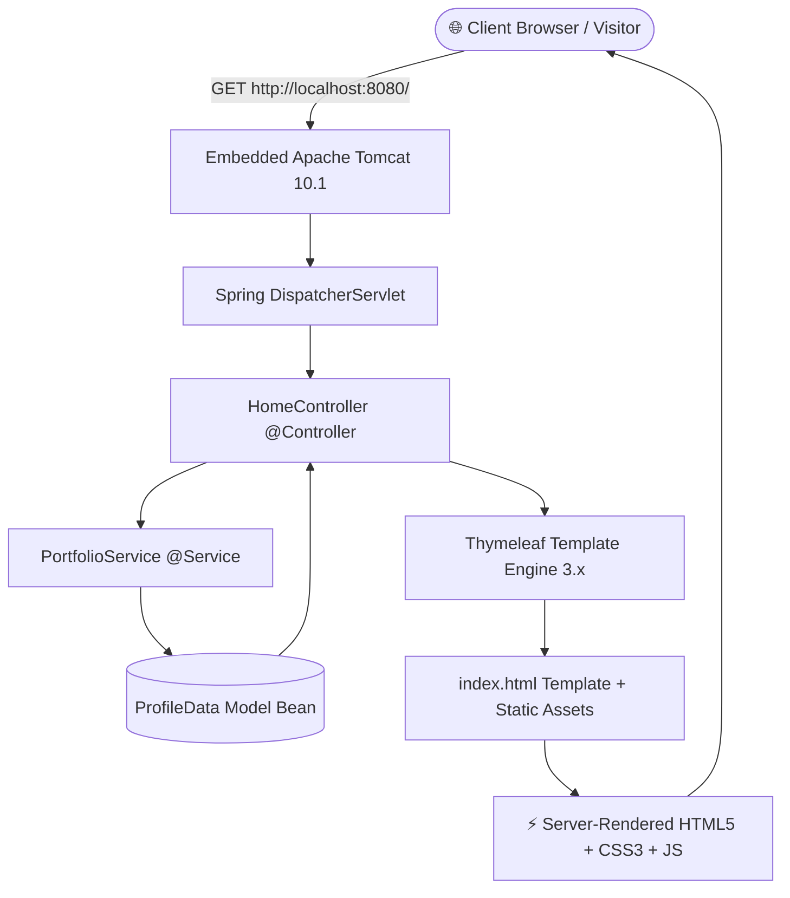
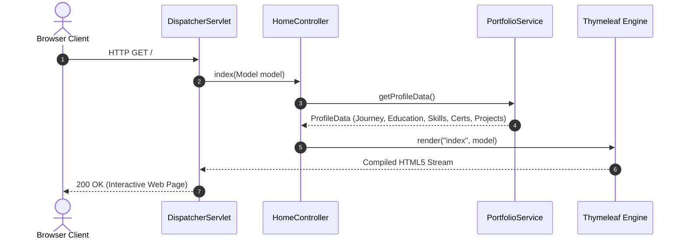

<div align="center">

# 💜 Khushi Singh — Official Developer Portfolio

### *Aspiring Java Full Stack Developer • BCA Student • Tech Enthusiast*

[](https://www.oracle.com/java/)
[](https://spring.io/projects/spring-boot)
[](https://www.thymeleaf.org/)
[](https://maven.apache.org/)
[](./LICENSE)
[](https://www.linkedin.com/in/khushi-singh-0a9a9738a/)

<p align="center">
  <b>“Turning ideas into meaningful projects through code.”</b>
</p>

[✨ Welcome Khushi!](./WELCOME.md) •
[👋 Handover & Quick Start](./WELCOME_KHUSHI.md) •
[✏️ How to Edit Content](./PORTFOLIO_GUIDE.md) •
[🛡️ Security Architecture](./SECURITY.md) •
[🚀 Quick Start](#-how-to-run-locally) •
[✨ Overview](#-overview) •
[🏛️ System Architecture](#-system-architecture) •
[📁 Codebase Map](#-codebase-map) •
[📜 License & Ownership](#-license--code-of-conduct)

---

> [!TIP]
> **Hey Khushi! 💜** Welcome to your personal developer portfolio codebase. You have 100% full ownership of this project. Check out **[WELCOME.md](./WELCOME.md)** and **[WELCOME_KHUSHI.md](./WELCOME_KHUSHI.md)** for inspirational guidance and beginner-friendly instructions on running, editing, and publishing your portfolio.

---

</div>

## 🌸 Overview

Welcome to the official personal portfolio website for **Khushi Singh**, built from the ground up as a high-performance, server-rendered web application using **Java 21**, **Spring Boot 3.3.4**, **Thymeleaf**, **HTML5 Semantic Markup**, **CSS3 Custom Properties**, and **Vanilla JavaScript**.

This portfolio presents a bespoke, atmospheric dark plum bento-grid experience framed by radiant violet-lavender aura lighting, spotlighting Khushi’s education at **Satyug Darshan Institute of Engineering & Technology**, verified credentials, specialized Java skillset, and comprehensive personal & collaborative software engineering projects.

> [!IMPORTANT]
> **Zero External JS Frameworks**: Engineered without React, Next.js, or heavyweight client bundles. Everything renders with blistering speed via server-side Thymeleaf templates and clean, optimized vanilla web standards.

---

## 🏛️ System Architecture

The application follows the robust **Spring Model-View-Controller (MVC)** architectural pattern, separating structured profile datasets, business logic, controller endpoints, and dynamic template rendering.

### 1. High-Level Request / Response Lifecycle



---

### 2. Bento Component Hierarchy

```mermaid
flowchart LR
    subgraph Viewport_100vh["🖥️ 100vh Fullscreen Hero Section"]
        Nav["Top Navbar\n(Brand + Links + Connect CTA)"]
        LeftCol["Left Column\n(Hello + Name + Bio + Socials)"]
        CenterCol["Center Column\n(Enlarged Portrait + Violet Halo)"]
        RightCol["Right Column\n(Creative Title + Mantra + Quote + Resume)"]
        ScrollCue["Scroll Indicator Cue"]
    end

    subgraph Bento_Scroll["📜 Scrollable Bento Grid Showcase"]
        About["About Me Card\n(Bio + Handwritten Photo Frame)"]
        Skills["My Skills Card\n(Focused Java Programming Stack)"]
        Journey["🌱 Learning Journey Card\n(6 Milestones: Java, OOP, Python, SQL, Git, Full-Stack)"]
        Edu["Education Card\n(SDIET BCA + Official Logo)"]
        Certs["Certifications Card\n(6 Verified Credentials: IBM, NPTEL, etc.)"]
        Projects["Projects Card\n(Personal & Collab Tabs + GitHub/Demo Links)"]
        Contact["Contact Me Card\n(LinkedIn + Location + Send Message)"]
        Footer["Site Footer"]
    end

    Viewport_100vh -->|User Scrolls Down| Bento_Scroll
```



---

### 3. Service to View Data Sequence



---

## 🎨 Visual Design System

The visual design is crafted around dark plum bento surfaces enveloped by a multi-stop lavender-to-deep-violet atmospheric canvas.

### 🎨 Color Palette Tokens

| Token Name | Hex / Value | Description |
|---|---|---|
| `--canvas-bg` | `#0b0714` | Deep background tone for full immersion |
| `--canvas-gradient` | `radial-gradient(#7c3aed 0%, #0d0914 100%)` | Radiant atmospheric violet halo |
| `--card-surface` | `#0d0914` | Main bento surface background |
| `--card-surface-inner`| `#140d21` | Inset component & badge surface |
| `--accent-purple` | `#a855f7` | Vibrant neon purple accent |
| `--accent-lavender` | `#c084fc` | Soft lavender typography highlight |
| `--border-card` | `rgba(168, 85, 247, 0.25)` | Subtle translucent neon purple borders |

---

## 🚀 How to Run Locally

### 1. System Prerequisites

Ensure **Java 21** is installed and accessible in your terminal.

```powershell
# Verify Java installation (Must be Java 21+)
java -version
```

*(If you do not have Java 21, download the latest OpenJDK / Temurin JDK 21 build).*

---

### 2. Clone the Repository

```bash
git clone https://github.com/Rishisharma029/portfolio.git
cd "kushu portfolio"
```

---

### 3. Launch the Application

#### 🪟 On Windows (PowerShell or Command Prompt):
```powershell
.\mvnw.cmd spring-boot:run
```

#### 🍎 On macOS / 🐧 Linux:
```bash
chmod +x ./mvnw
./mvnw spring-boot:run
```

---

### 4. Open in Your Browser

Once the console displays `Started PortfolioApplication in X seconds`, open your browser at:

👉 **[http://localhost:8080](http://localhost:8080)**

---

### 5. Running Automated Test Suites

```powershell
# Run unit & MockMvc integration tests
.\mvnw.cmd test
```

Expected output:
```text
[INFO] Tests run: 2, Failures: 0, Errors: 0, Skipped: 0
[INFO] BUILD SUCCESS
```

---

### 6. Packaging for Production JAR

```powershell
# Build standalone executable JAR
.\mvnw.cmd clean package -DskipTests
```

Run the built JAR directly:
```powershell
java -jar target/kushu-portfolio-0.0.1-SNAPSHOT.jar
```

---

## 📁 Codebase Map

```text
kushu-portfolio/
├── pom.xml                                        # Maven Project Object Model & dependencies
├── mvnw & mvnw.cmd                                # Cross-platform Maven Wrappers
├── LICENSE                                        # Proprietary Restricted License (Khushi Singh)
├── CODE_OF_CONDUCT.md                             # Contributor Covenant Code of Conduct
├── README.md                                      # Documentation, Architecture & Run Guide
├── src/
│   ├── main/
│   │   ├── java/com/kushu/portfolio/
│   │   │   ├── PortfolioApplication.java          # Spring Boot main application entrypoint
│   │   │   ├── controller/
│   │   │   │   └── HomeController.java            # MVC Controller mapping GET "/" to index
│   │   │   ├── model/
│   │   │   │   └── ProfileData.java               # Immutable data transfer objects & models
│   │   │   └── service/
│   │   │       └── PortfolioService.java          # In-memory service delivering verified profile data
│   │   └── resources/
│   │       ├── application.properties             # Spring Boot port & template cache configuration
│   │       ├── templates/
│   │       │   └── index.html                     # Thymeleaf 3 server-rendered HTML5 template
│   │       └── static/
│   │           ├── css/
│   │           │   └── style.css                  # Custom styling, 100vh hero, and responsive tokens
│   │           ├── js/
│   │           │   └── main.js                    # Navigation tracking, project tab filters & toast alerts
│   │           └── images/
│   │               ├── khushi-portrait.png        # Transparent feathered hero portrait
│   │               ├── khushi-photo-crop.jpg      # About card thumbnail portrait
│   │               └── sdiet-logo.png             # Official Satyug Darshan Institute emblem
│   └── test/
│       └── java/com/kushu/portfolio/
│           ├── PortfolioApplicationTests.java     # Spring application context verification
│           └── controller/
│               └── HomeControllerTest.java        # WebMvc endpoint & HTML content assertions
```

---

## 🌱 Her Learning Journey (Interactive Roadmap)

One of the most personal and inspiring features of this portfolio is Khushi’s **Learning Journey Timeline**. It charts her chronological progression from her very first lines of code to production-grade enterprise Java engineering:

| Phase | Milestone Title | Status | Period | Core Focus |
|---|---|---|---|---|
| **Phase 01** | **Java Fundamentals & Logic** | `COMPLETED` | 2025 | Primitive types, loops, conditionals, arrays, logic |
| **Phase 02** | **Object-Oriented Programming** | `COMPLETED` | Early 2026 | Encapsulation, inheritance, polymorphism, collections |
| **Phase 03** | **Python & Algorithmic Foundations**| `COMPLETED` | Apr 2026 | Scripting, data structures, automation, AI basics |
| **Phase 04** | **Databases & Data Modeling (SQL)** | `IN_PROGRESS` | Mid 2026 | RDBMS, normalization, joins, CRUD, JDBC |
| **Phase 05** | **Git & Collaborative Workflows** | `IN_PROGRESS` | 2026 | Branching, pull requests, open-source teamwork |
| **Phase 06** | **Full-Stack Java & Spring Boot** | `IN_PROGRESS` | Present & Beyond | Spring Boot 3.x, MVC, REST APIs, Thymeleaf UI |

### ✏️ How to Edit or Add Milestones
The timeline is **100% data-driven and easily editable** as Khushi learns new technologies. To update any milestone or add a new phase, simply modify the `journey` list in [`PortfolioService.java`](./src/main/java/com/kushu/portfolio/service/PortfolioService.java):

```java
journey.add(new ProfileData.LearningMilestone(
    "m7",                                      // Unique ID
    "Phase 07",                                // Phase label
    "Microservices & Cloud Deployment",        // Title
    "UPCOMING",                                // Status: "COMPLETED", "IN_PROGRESS", or "UPCOMING"
    "Upcoming",                                // Display label
    "Late 2026",                               // Timeframe
    "fullstack",                               // Icon type
    "Designing distributed microservices...",  // Narrative summary
    List.of("Docker", "Spring Cloud", "K8s"),  // Topic chips
    "“Scaling systems to millions of users.”"  // Heartfelt reflection
));
```

---

## 🤝 Projects Showcase

The **Projects** section includes an interactive tabbed switcher (`Personal` vs. `Collab` vs. `All`):

### 🌟 1. Personal Projects
* **Java Full Stack Web Platform**: Modern Spring Boot web application with Thymeleaf server rendering and dynamic MVC architecture.
* **Java OOP & Data Structures Suite**: Structured algorithms, OOP design patterns, and utility suites.

### 🤝 2. Collaborative Projects (`Collab`)
* [CampusOS AI](https://github.com/Rishisharma029/campusOS) — AI-powered university OS covering campus operations, administration, and assistants.
* [CareerGraph AI](https://github.com/Rishisharma029/careergraph-ai) • [Live Demo](https://rishisharma029.github.io/careergraph-ai/) — Knowledge graph career timeline & RAG search engine.
* [Handwritten Digital Recognition System](https://github.com/Rishisharma029/handwritten-digital-recognition-system) • [Live Demo](https://rishisharma029.github.io/handwritten-digital-recognition-system/) — OCR pipeline converting handwritten notes to searchable text.
* [EvalSync-System](https://github.com/Rishisharma029/EvalSync-System) — Academic paper-checking & grading workflow platform.
* [ResQNet](https://github.com/Rishisharma029/resqnet) — Incident management & emergency volunteer dispatch GIS platform.
* [Teacher-Check](https://github.com/Rishisharma029/teacher-check) — Foundational-learning assessment project.
* [BhoomiLens](https://github.com/Rishisharma029/bhoomilens) — Geospatial satellite & terrain analysis project.
* [Developer Portfolio](https://github.com/Rishisharma029/portfolio) — Portfolio web application.
* [AI Engineering Workshop](https://github.com/Rishisharma029/ai-engineering-workshop) — LLMs and generative agents implementation repository.
* **TRAVIA** — Smart tourism ecosystem with travel discovery.
* **LeafSense AI** — MobileNetV2 crop disease classification.
* **SolarFlare-AI** — Solar-flare forecasting scientific model.
* **W3A1** — Web3 blockchain service marketplace.

---

## 📜 License & Code of Conduct

* **License**: **Custom Proprietary & Restricted License**. Copyright &copy; 2026 **Khushi Singh**. All rights reserved. Except for Khushi Singh, unauthorized copying, commercial reuse, or public redistribution is strictly restricted. See [LICENSE](./LICENSE) for full legal terms.
* **Code of Conduct**: This repository enforces the [Contributor Covenant v2.1](./CODE_OF_CONDUCT.md).

---

<div align="center">

### 💜 Built with passion & dedication for Khushi Singh

**[Connect on LinkedIn](https://www.linkedin.com/in/khushi-singh-0a9a9738a/)** • **Faridabad, Haryana, India**

</div>
